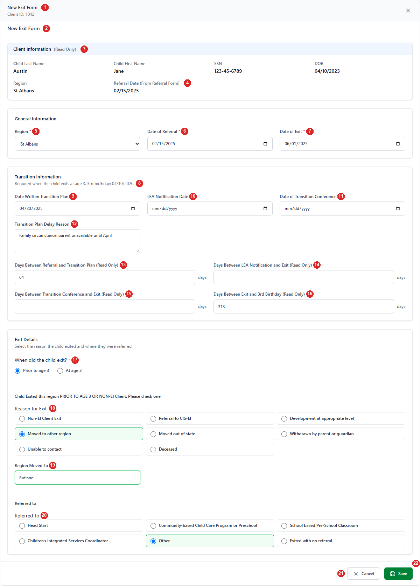
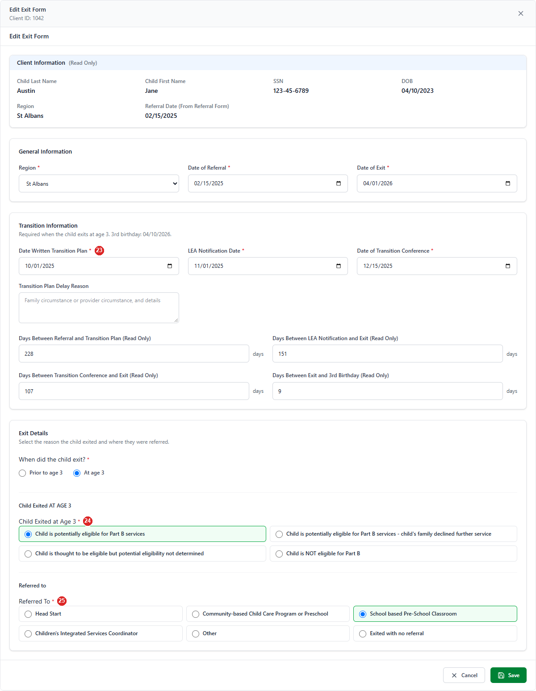
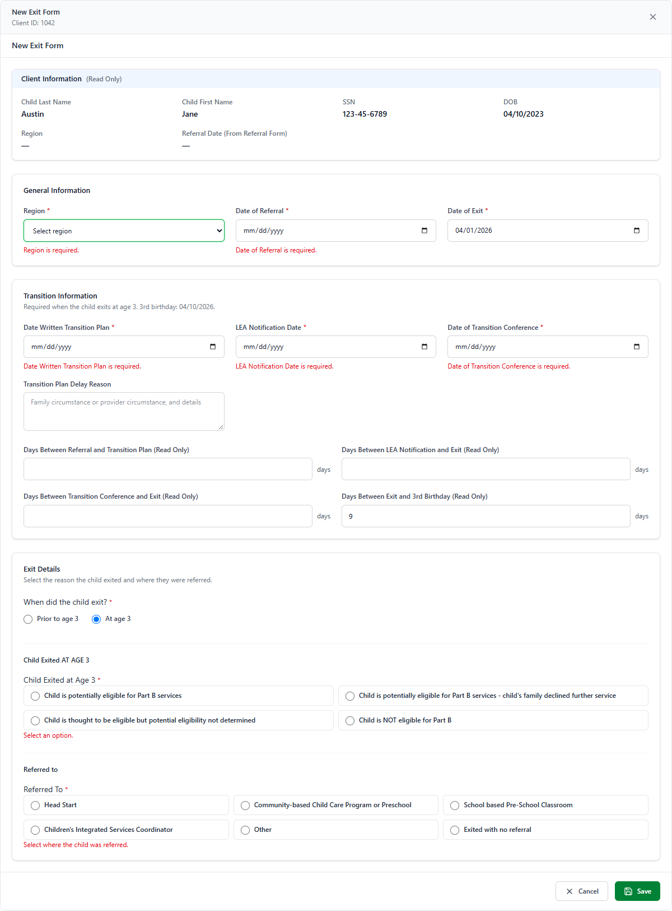

# 00 — Annotated Wireframe: Exit Form

Screenshots of the Exit Form as built today, taken from the running React components with sample data. The form opens as a full-screen modal from the Client screen → **Input Forms** tab → **Exit** (new form) or **View/Edit** on an Exit row (edit). Numbered red markers match the tables below. Sample data is fictional.

Rules referenced as `BR-EF-…` / `EF-GAP-…` are in [03-business-rules.md](03-business-rules.md); fields are specified in [06-field-spec.md](06-field-spec.md).

*Figure 1 — New form. Region and Date of Referral are prefilled from the child's latest Active / Referral form; the exit date is before the 3rd birthday, so "Prior to age 3" is selected automatically.*

*Figure 2 — Editing a form where the child exited at age 3: the three transition dates and Referred To become required (markers 23–25).*

*Figure 3 — Save pressed with missing data: each field shows its message and a toast says "Please fix the highlighted fields."*

---

## Header and Client Information

| # | Element | Type | Behaviour | Data | Rules |
| - | ------- | ---- | --------- | ---- | ----- |
| 1 | Modal header | Title, Client ID, × | "New Exit Form" / "Edit Exit Form" and the Client ID. × closes without saving. | `ChildID` | BR-EF-01, 06 |
| 2 | Page heading | Text | Repeats "New Exit Form" / "Edit Exit Form" (EF-GAP-12). | mode | BR-EF-05 |
| 3 | Client details | Read-only labels | Child Last Name, First Name, SSN (unmasked), DOB (MM/DD/YYYY). County and Status are **not shown** on this form. | `stblPeople` | BR-EF-24, EF-GAP-13 |
| 4 | Region, Referral Date (From Referral Form) | Read-only labels | Follow the Region and Date of Referral fields below as the user types. | form values | BR-EF-24, EF-GAP-11 |

## General Information

| # | Element | Type | Behaviour | Data | Rules |
| - | ------- | ---- | --------- | ---- | ----- |
| 5 | Region * | Dropdown | Active regions; "Select region" = 0. New forms: prefilled. "Region is required." | `Region` | BR-EF-20, 21 |
| 6 | Date of Referral * | Date | Required; not before DOB. New forms: prefilled from the latest Active / Referral form. | `ReferralDate` | BR-EF-21, 22 |
| 7 | Date of Exit * | Date | Required; not before DOB or Date of Referral. Also sets `FormDate`. | `ExitDate` (+ `FormDate`) | BR-EF-11, 23 |

## Transition Information

| # | Element | Type | Behaviour | Data | Rules |
| - | ------- | ---- | --------- | ---- | ----- |
| 8 | Section description | Text | "Required when the child exits at age 3." plus the **3rd birthday** (DOB + 3 years) when the DOB is known. | DOB | BR-EF-36 |
| 9 | Date Written Transition Plan | Date | Required only for an exit at age 3. Not before Date of Referral; not after Date of Exit. | `TransitionPlanCompleted` | BR-EF-30..33 |
| 10 | LEA Notification Date | Date | Same rules as 9. | `CLLEANotificationDate` | BR-EF-30..33 |
| 11 | Date of Transition Conference | Date | Required only for an exit at age 3; not after Date of Exit. | `TransitionMeeting` | BR-EF-30, 32 |
| 12 | Transition Plan Delay Reason | Text area | Optional. Placeholder: "Family circumstance or provider circumstance, and details". | `TransitionPlanReason` | BR-EF-34, EF-GAP-05 |
| 13 | Days Between Referral and Transition Plan | Read-only number | Transition Plan date − Date of Referral. Not saved. | — | BR-EF-35 |
| 14 | Days Between LEA Notification and Exit | Read-only number | Date of Exit − LEA Notification Date. Not saved. | — | BR-EF-35 |
| 15 | Days Between Transition Conference and Exit | Read-only number | Date of Exit − Transition Conference. Not saved. | — | BR-EF-35 |
| 16 | Days Between Exit and 3rd Birthday | Read-only number | 3rd birthday − Date of Exit (negative after the birthday). Not saved. | — | BR-EF-35 |

## Exit Details

| # | Element | Type | Behaviour | Data | Rules |
| - | ------- | ---- | --------- | ---- | ----- |
| 17 | When did the child exit? * | Radio: Prior to age 3 / At age 3 | Picks which list is shown. New forms follow the exit date until the user picks: "At age 3" from 31 days before the 3rd birthday. | UI only (decides which code column is filled) | BR-EF-40 |
| 18 | Reason for Exit * (prior to age 3) | Radio ×8 | Non-EI Client Exit, Referral to CIS-EI, Development at appropriate level, Moved to other region, Moved out of state, Withdrawn by parent or guardian, Unable to contact, Deceased. | `ExitPriorToAge3` (7, 8, 1–6) | BR-EF-41, 42 |
| 19 | Region Moved To | Text | Shown only for "Moved to other region"; max 255. | `MovedOtherRegion` | BR-EF-43 |
| 20 | Referred To | Radio ×6 | Head Start, Community-based Child Care Program or Preschool, School based Pre-School Classroom, Children's Integrated Services Coordinator, Other, Exited with no referral. Optional for prior to age 3. | `ReferredTo` (1–5, 99) | BR-EF-47, 48 |
| 23 | Transition dates (at age 3) | Required markers | The three transition dates show `*` and are required. | — | BR-EF-30 |
| 24 | Child Exited at Age 3 * | Radio ×4 | Potentially eligible for Part B · Potentially eligible – family declined · Thought eligible – eligibility not determined · NOT eligible for Part B. | `ExitAtAge3` (1–4) | BR-EF-44, 46 |
| 25 | Referred To * (at age 3) | Radio ×6 | Required for an exit at age 3. | `ReferredTo` | BR-EF-47 |

## Actions

| # | Element | Behaviour | Messages |
| - | ------- | --------- | -------- |
| 21 | Cancel | Closes without saving (no warning). | — |
| 22 | Save | Validates, then creates (POST) or updates (PUT); the Input Forms grid refreshes and the modal closes. Shows "Saving..." while busy. | "Exit Form saved successfully." / "Exit Form updated successfully." / "Please fix the highlighted fields." / server message or "Failed to save Exit Form." |

**Other screen states:** "Loading Exit Form..." · "Exit Form could not be loaded." · "Exit Form record not found." (edit, then the modal closes).
