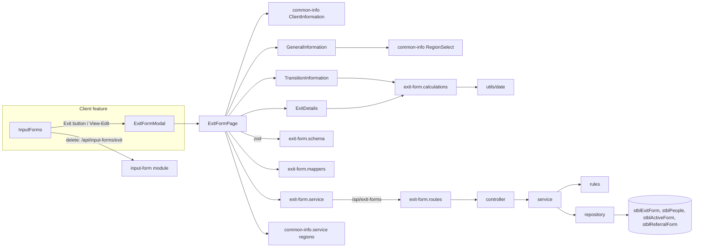

# 01 — Code Annotations: Exit Form

File-by-file walkthrough of the Exit Form feature at commit `a7916f6` (branch `feature/exit-form`, 2026-11-02). Line references are to that commit.

---

## 1. Architecture

The form uses **react-hook-form** with a **zod** resolver. All sections share one form context (`FormProvider`). The backend splits pure rules (`exit-form.rules.ts`) from database access (`exit-form.repository.ts`), so the rules are unit-tested without a database.

---

## 2. Backend — `backend/src/modules/exit-form`

| File | Annotation |
| ---- | ---------- |
| [index.ts](../../backend/src/modules/exit-form/index.ts) | Exports the router as `exitFormRoutes` (mounted at `/api/exit-forms` in [app.ts:61](../../backend/src/app.ts#L61), no auth) and the types. |
| [exit-form.routes.ts](../../backend/src/modules/exit-form/exit-form.routes.ts) | `GET /lookups/options` first (so `lookups` isn't read as a child ID), then `GET/POST /:childId`, `GET /:childId/defaults`, `GET/PUT/DELETE /:childId/:id`. Every route has `@swagger` comments (schemas `ExitFormInput`, `ExitForm`), so the API appears in `/api-docs`. |
| [exit-form.controller.ts](../../backend/src/modules/exit-form/exit-form.controller.ts) | One-line adapters. `create` returns **201**; the body defaults to `{}`. |
| [exit-form.types.ts](../../backend/src/modules/exit-form/exit-form.types.ts) | `ExitFormRecord` (open record), `ExitFormClient` (the `stblPeople` header), `ExitFormDefaults` (`Region`, `ReferralDate`). |
| [exit-form.config.ts](../../backend/src/modules/exit-form/exit-form.config.ts) | Table names (`ACTIVE_FORM_TABLE` is re-exported from the Active Form config); `EXIT_FORM_TYPE = 'Exit'`; `COLUMNS` — the 38 writable columns with a kind (`int`, `yesNo`, `bit`, `date`, `text`) and max length, used for both parsing and SQL binding; the three code lists `EXIT_PRIOR_TO_AGE_3`, `EXIT_AT_AGE_3`, `REFERRED_TO`; and the constants `NOT_THIS_EXIT_PATH = 0`, `EXIT_AT_AGE_3_NOT_ELIGIBLE = 4`, `EXIT_PRIOR_MOVED_OTHER_REGION = 2`. |

### 2.1 [exit-form.rules.ts](../../backend/src/modules/exit-form/exit-form.rules.ts)

| Function | Annotation |
| -------- | ---------- |
| `error(message, status)` | Throws an `Error` tagged with a status (400 by default). The global error middleware ignores the tag and returns 500 (EF-GAP-08). |
| `toIsoDate(value)` | `Date`, ISO timestamp or `YYYY-MM-DD` → `YYYY-MM-DD`, else null. Used to compare dates as strings. |
| `parseDate` / `parseInt32` / `parseYesNo` / `parseBit` / `parseText` | Per-kind parsing. Dates must be `YYYY-MM-DD` and real (round-trip check). Yes/No accepts `true/false`, `yes/no`, `-1/0/1` and stores `-1` / `0`. Text is trimmed, blank → null, and checked against the column length. |
| `checkCode(value, field, options, allowNotThisPath)` | Rejects a code that isn't in the list ("… has an unknown value: …"); the exit-path columns also allow `0`. |
| `normalizePayload(raw)` ([:103](../../backend/src/modules/exit-form/exit-form.rules.ts#L103)) | Body → typed columns. Drops unknown keys, `ID`, `ChildID` and **`FormType`** (always `'Exit'`). Returns only keys that were sent, so it works for partial updates. |
| `applyExitPath(p)` ([:148](../../backend/src/modules/exit-form/exit-form.rules.ts#L148)) | When one path has a real code, sets the other path's column to **0** (legacy convention). |
| `clearDependentFields(p)` ([:163](../../backend/src/modules/exit-form/exit-form.rules.ts#L163)) | `MovedOtherRegion` → null unless `ExitPriorToAge3 = 2`; `EXFNoPartB1-3` → false unless `ExitAtAge3 = 4`. Only when that answer is part of the save. |
| `validateRecord(record, dob)` ([:175](../../backend/src/modules/exit-form/exit-form.rules.ts#L175)) | Cross-field rules on the merged record: dates not before DOB; exit not before referral; transition plan and LEA dates not before referral; transition dates not after exit; not both paths; Referred To required when `ExitAtAge3 = 4`. |

### 2.2 [exit-form.service.ts](../../backend/src/modules/exit-form/exit-form.service.ts)

| Function | Annotation |
| -------- | ---------- |
| `int(value, name)` | Positive-integer check for `ChildID` / `ID`. |
| `child(childId)` | Loads the client or throws "Client not found" (404). |
| `prepare(raw)` | `normalizePayload` → `applyExitPath` → `clearDependentFields`. |
| `get` | Returns `{ client, forms }`. |
| `getOne` | One form, or "Exit Form not found" (404). |
| `create` | Requires `Region` and `ExitDate`; sets `FormDate = ExitDate` when not sent; validates; inserts. |
| `update` | Requires the row to exist. `Region` / `ExitDate` can't be cleared. If the saved `FormDate` equalled the saved `ExitDate`, a new `ExitDate` moves `FormDate` too. Validates the **merged** row; partial update. |
| `remove` | Deletes; "Exit Form not found" if 0 rows. Returns `{ success: true }`. |
| `defaults` | Prefill for a new form: `Region` and `ReferralDate` from the latest Active form, falling back to the latest Referral form, then the client's region. |
| `lookups.options` | Returns the three code lists from the config. |

### 2.3 [exit-form.repository.ts](../../backend/src/modules/exit-form/exit-form.repository.ts)

| Function | Annotation |
| -------- | ---------- |
| `clean(payload)` | Keeps only `COLUMNS` keys (second guard after the rules). |
| `bind(req, key, value)` | Types parameters from the column kind: dates as `NVarChar(10)` (the legacy "SQL Server" ODBC driver rejects date parameters, HY004), `int`/`yesNo` as `Int`, `bit` as `Bit`, text as `NVarChar(max length)`. |
| `col(name)` | Brackets a column name. Safe because names come from `COLUMNS`. |
| `getClient` | `stblPeople` header for the form. |
| `findByChildId` | `SELECT *` for the client, newest exit first (`ExitDate` nulls last, then `ID DESC`). |
| `findOne` | One row by `ChildID` + `ID`. |
| `insert` | `INSERT (ChildID, FormType='Exit', …keys) OUTPUT INSERTED.ID`, then re-reads the row. |
| `update` | `UPDATE SET …keys, LastUpdateDate = GETDATE(), LastUpdateUser = SUSER_SNAME()`; re-reads. No keys → just re-reads. |
| `remove` | `DELETE` + `SELECT @@ROWCOUNT`. |
| `findLatestReferral` | Latest `stblReferralForm` by `COALESCE(ReReferralDate, ReferralDate, FormDate)`. |
| `findLatestActive` | Latest `stblActiveForm` by `FormDate`. |

---

## 3. Frontend — `frontend/src/features/exit-form`

| File | Annotation |
| ---- | ---------- |
| [index.ts](../../frontend/src/features/exit-form/index.ts) | Exports `ExitFormPage`. |
| [schemas/exit-form.schema.ts](../../frontend/src/features/exit-form/schemas/exit-form.schema.ts) | `createExitFormSchema(dob)`: Region ≥ 1; Date of Referral and Date of Exit required; date format; then the same cross-field rules as the backend, plus: exit path required, a reason required for its path, and for **at age 3** the outcome, Referred To and all three transition dates required. |
| [utils/exit-form.calculations.ts](../../frontend/src/features/exit-form/utils/exit-form.calculations.ts) | `thirdBirthday(dob)`, `calculateExit(values, dob)` (the four day counts) and `suggestExitPath(exitDate, dob)` (at age 3 from 31 days before the 3rd birthday). Built on the shared [utils/date.ts](../../frontend/src/utils/date.ts) (`toDateInput`, `daysBetween`, `addToDate`, `formatDate` — UTC, so daylight saving can't shift a count). |
| [utils/exit-form.mappers.ts](../../frontend/src/features/exit-form/utils/exit-form.mappers.ts) | `recordToValues` (DB row → form; `0`/null codes → not chosen; the path comes from whichever code is set), `defaultsToValues` (prefill), `valuesToPayload` (form → API: only the fields on the screen; the other path's code and `MovedOtherRegion` are sent as null). |
| [components/ExitFormControls.tsx](../../frontend/src/features/exit-form/components/ExitFormControls.tsx) | `Section` (card with title and description) and `SubSection`. |

### 3.1 [pages/ExitFormPage.tsx](../../frontend/src/features/exit-form/pages/ExitFormPage.tsx)

Props: `childId`, `formId?` (edit when set), `onClose`, `onSaved?`.

| Part | Annotation |
| ---- | ---------- |
| `apiMessage` | Server `message` (or `error`) from an Axios error, else a fallback. |
| `ClientAndGeneral` | Watches `Region` and `ReferralDate` so the read-only Client Information shows the selected region's name and the typed referral date. |
| Load effect | In parallel: `GET /api/exit-forms/{childId}`, regions, options, and (new only) `GET …/defaults`. Edit mode finds the form by ID or shows "Exit Form record not found." and closes. |
| Schema | Rebuilt when the DOB is known (`useMemo`). Validation runs on submit. |
| `saveForm` | `valuesToPayload` → PUT (edit) or POST (new) → success toast → `onSaved()` (parent reloads and closes). Errors show the server message. |
| Render | Loading / error states; sticky header; Client Information, General, Transition, Exit Details; sticky footer Cancel / Save ("Saving..."). |

### 3.2 Sections

| Component | Annotation |
| --------- | ---------- |
| [GeneralInformation.tsx](../../frontend/src/features/exit-form/components/GeneralInformation.tsx) | Region (`RegionSelect`, `valueAsNumber`, placeholder 0), Date of Referral, Date of Exit — all required. |
| [TransitionInformation.tsx](../../frontend/src/features/exit-form/components/TransitionInformation.tsx) | Three dates (required only when the path is at age 3), Transition Plan Delay Reason (textarea), and four read-only day counts from `calculateExit`. The description shows the 3rd birthday. |
| [ExitDetails.tsx](../../frontend/src/features/exit-form/components/ExitDetails.tsx) | Path radios; an effect suggests the path for new forms until the user picks one ([:34](../../frontend/src/features/exit-form/components/ExitDetails.tsx#L34)). Prior → reason radios (+ "Region Moved To" for code 2). At age 3 → outcome radios. Referred To radios once a path is chosen (required for at age 3). |

### 3.3 Shared files outside the feature

| File | Annotation |
| ---- | ---------- |
| [common-info/components/ClientInformation.tsx](../../frontend/src/features/common-info/components/ClientInformation.tsx) | Shared read-only client card. County and Status show only when passed; the Exit Form doesn't pass them. |
| [common-info](../../frontend/src/features/common-info/index.ts) `Field`, `FieldGroup`, `RegionSelect`, `inputClass` | Shared form controls; required fields show `*` inside the label. |
| [services/exit-form.service.ts](../../frontend/src/services/exit-form.service.ts) | Axios wrapper: `get`, `defaults`, `create`, `update`, `options`. |
| [types/exit-form.ts](../../frontend/src/types/exit-form.ts) | `ExitFormClient`, `ExitFormRecord`, `ExitFormDefaults`, `ExitFormOptions`, `ExitFormCalculated`, `ExitFormValues`, `DEFAULT_EXIT_FORM_VALUES`. |
| [client/components/InputForm/InputForms.tsx](../../frontend/src/features/client/components/InputForm/InputForms.tsx) | Hosts `ExitFormModal`; deletes Exit rows through the generic input-form API. |

### 3.4 Tests

| Area | File | Test cases |
| ---- | ---- | ---------- |
| Backend | `exit-form.rules.test.ts` | 59 |
| Backend | `exit-form.service.test.ts` | 50 |
| Backend | `exit-form.repository.test.ts` | 20 |
| Backend | `exit-form.controller.test.ts` | 11 |
| Backend | `exit-form.routes.test.ts` | 9 |
| Frontend | `ExitFormPage.test.tsx` | 25 |
| Frontend | `exit-form.schema.test.ts` | 23 |
| Frontend | `exit-form.mappers.test.ts` | 16 |
| Frontend | `ExitDetails.test.tsx` | 15 |
| Frontend | `exit-form.calculations.test.ts` | 13 |
| Frontend | `TransitionInformation.test.tsx` | 12 |
| Frontend | `utils/date.test.ts` (shared) | 12 |
| Frontend | `GeneralInformation.test.tsx` | 8 |
| Frontend | `services/exit-form.service.test.ts` | 6 |
| Frontend | `ExitFormControls.test.tsx` | 3 |

Counts are `it`/`test` blocks; `it.each` blocks run once per row, so the backend suite runs 196 tests for the module. Frontend tests run in Vitest browser mode (Chromium).
