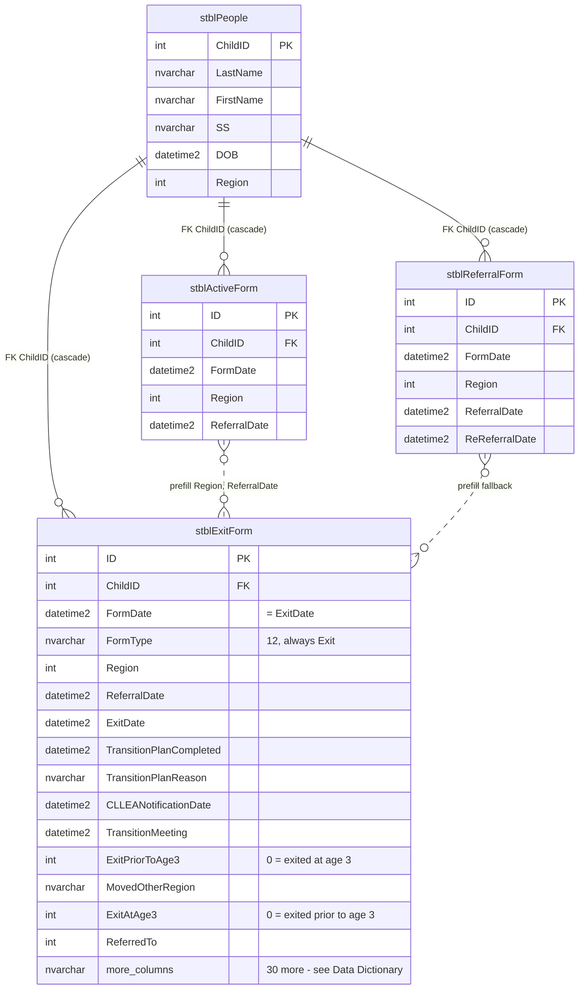
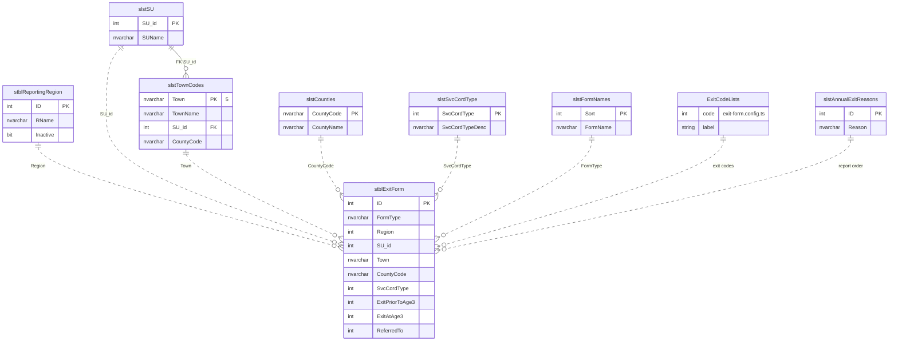

# 07 — Entity-Relationship Diagram: Exit Form

Built from the `dbCDD` DDL (2026-09-09), checked against the local database. Solid lines are **physical FKs**; dashed lines are **logical** relationships (used by queries, not enforced by the database).

`stblExitForm` has 45 columns. The diagrams show the key and referencing columns only; see [04-data-dictionary.md](04-data-dictionary.md) for every column, grouped as: header (6), location / coordinator / referral (11), COSF questions (6), exit date and transition (10), exit reason and referral (7), audit (5).

---

## 1a. Core: the form, its client and the forms it's prefilled from

## 1b. Lookups and code lists referenced by the form

Only the referencing columns of `stblExitForm` are shown. The three exit code lists have **no table** in `dbCDD`; they live in the backend config.

## 2. Relationship catalogue

| # | Parent | Child | Join | Physical FK | On delete | Notes |
| - | ------ | ----- | ---- | ----------- | --------- | ----- |
| R1 | `stblPeople` | `stblExitForm` | `ChildID` | `stblExitForm$stblPeoplestblExitForm` (`WITH NOCHECK`) | **Cascade** | Deleting a client deletes its Exit Forms |
| R2 | `stblActiveForm` | `stblExitForm` | `ChildID`, latest by `FormDate` | No | — | Prefill of `Region` and `ReferralDate` for a new form |
| R3 | `stblReferralForm` | `stblExitForm` | `ChildID`, latest by re-referral / referral date | No | — | Prefill fallback |
| R4 | `stblReportingRegion` | `stblExitForm` | `Region = ID` | No | — | UI picks from active regions |
| R5 | `slstSU` | `stblExitForm` | `SU_id` | No | — | Not on the screen **[Decision]** |
| R6 | `slstTownCodes` | `stblExitForm` | `Town` | No | — | Form column `nvarchar(3)`, lookup key `nvarchar(5)` |
| R7 | `slstCounties` | `stblExitForm` | `CountyCode` | No | — | Not on the screen |
| R8 | `slstSvcCordType` | `stblExitForm` | `SvcCordType` | No | — | Not on the screen |
| R9 | `slstFormNames` | `stblExitForm` | `FormType = FormName` (text) | No | — | Always `'Exit'`, so it matches |
| R10 | *(config)* code lists | `stblExitForm` | `ExitPriorToAge3`, `ExitAtAge3`, `ReferredTo` | No | — | No table; values checked by the backend |
| R11 | `slstAnnualExitReasons` | `stblExitForm` | reports map codes to `ID` with `Choose(...)` | No | — | Codes 7 and 8 have no mapping (EF-GAP-02) |
| R12 | `slstSU` | `slstTownCodes` | `SU_id` | `slstTownCodes$slstSUslstTownCodes` | No action | Only FK among the lookups |

## 3. Notes for the DBA

1. The only enforced relationship is R1 (cascade), and it was created `WITH NOCHECK`, so SQL Server doesn't trust it for query plans. Re-enable it `WITH CHECK` after confirming there are no orphans.
2. No index on `stblExitForm.ChildID`; the client lookup (`WHERE ChildID = …`), the Input Forms history and the cascade delete scan the table.
3. The exit code lists exist only in code and in column descriptions. A lookup table (`slstExitReasonPriorToAge3`, `slstExitAtAge3`, `slstReferredTo`) would let reports join instead of hard-coding `Choose(...)` mappings.
