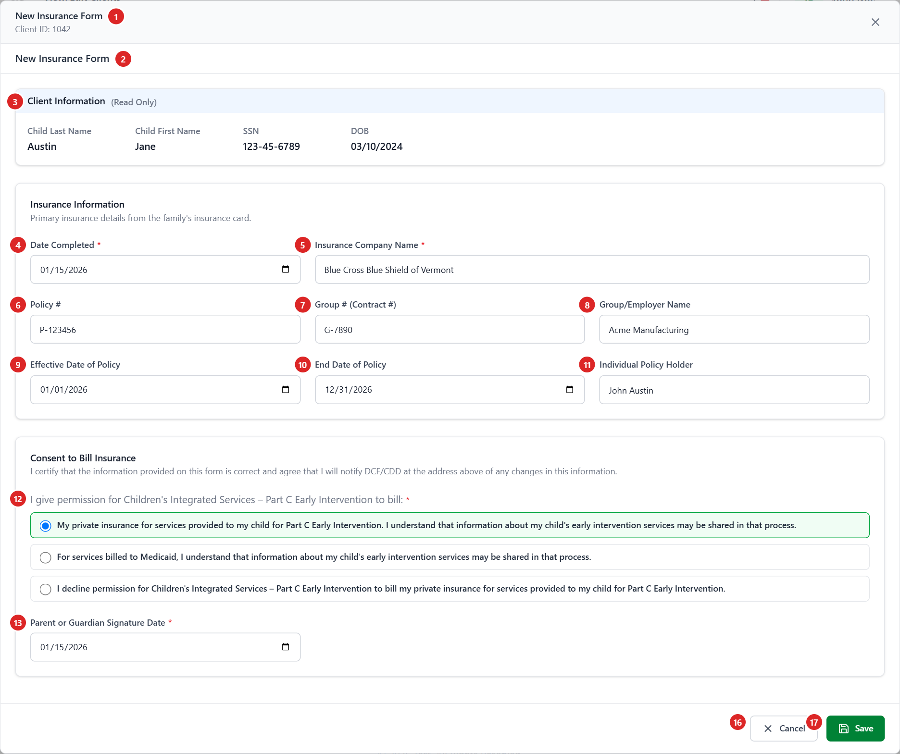
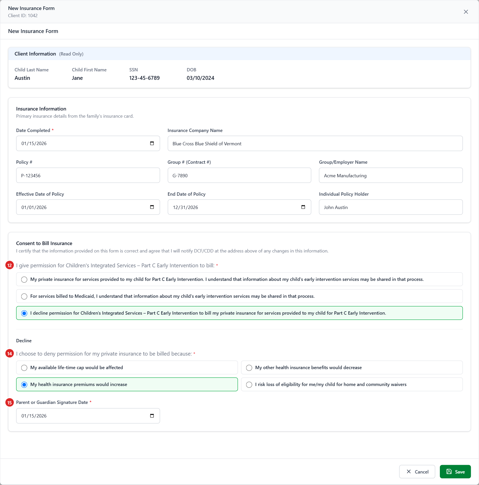
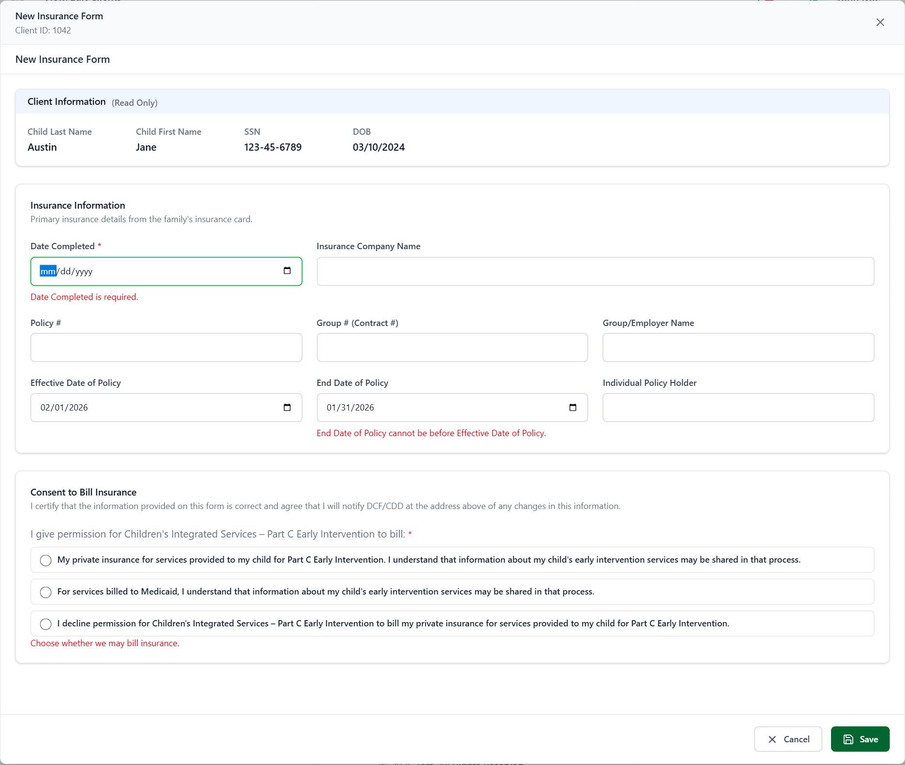

# 00 — Annotated Wireframe: Insurance Form

Screenshots of the Insurance Form as built today, taken from the running application with sample data. The form opens as a full-screen modal from the Client screen → **Input Forms** tab → **Insurance** (new form) or **View/Edit** on an Insurance row (edit). Numbered red markers match the tables below. Sample data is fictional.

**Figure 1 — New form, permission to bill private insurance**

**Figure 2 — Decline billing private insurance**

**Figure 3 — Save with missing and invalid values**

---

## Header and Client Information

| # | Element | Type | Behaviour | Data | Rules |
| - | ------- | ---- | --------- | ---- | ----- |
| 1 | Modal header | Title, Client ID, × | "New Insurance Form" / "Edit Insurance Form" and the Client ID. × closes without saving. | `ChildID` | BR-IF-01, 06 |
| 2 | Page heading | Text | Repeats the modal title (IF-GAP-09). | mode | BR-IF-05 |
| 3 | Client Information | Read-only labels | Child Last Name, First Name, SSN (unmasked), DOB (MM/DD/YYYY). No Region or Referral Date: this form records neither. | `stblPeople` | IF-GAP-10 |

## Insurance Information

| # | Element | Type | Behaviour | Data | Rules |
| - | ------- | ---- | --------- | ---- | ----- |
| 4 | Date Completed * | Date | Required; not before DOB; picker starts at DOB. Shown in the Input Forms history; FITP picks the latest form by this date. | `FormDate` | BR-IF-11, 36, 40 |
| 5 | Insurance Company Name | Text (255) | Required (red `*` appears) only when consent 1 is chosen. Saved in `BranchAddress` **[Decision]**. | `BranchAddress` | BR-IF-20, 32 |
| 6 | Policy # | Text (255) | Optional. FITP sends the first 20 characters (IF-GAP-07). | `PolicyNumber` | BR-IF-21, 42 |
| 7 | Group # (Contract #) | Text (255) | Optional. FITP sends the first 16 characters (IF-GAP-07). | `GroupNumber` | BR-IF-21, 42 |
| 8 | Group/Employer Name | Text (255) | Optional. | `GroupName` | BR-IF-21 |
| 9 | Effective Date of Policy | Date | Optional. Sent to FITP. | `EffectiveDate` | BR-IF-22, 42 |
| 10 | End Date of Policy | Date | Optional; not before Effective Date (picker starts there). Sent to FITP. | `EndDate` | BR-IF-22, 42 |
| 11 | Individual Policy Holder | Text (255) | Optional. | `PolicyHolder` | BR-IF-21 |

Removed from the legacy screen (not used any more): Ins. Co # dropdown, Coverage Code dropdown, Phone. Their columns are kept untouched (BR-IF-23).

## Consent to Bill Insurance

| # | Element | Type | Behaviour | Data | Rules |
| - | ------- | ---- | --------- | ---- | ----- |
| 12 | I give permission … to bill: * | 3 option cards (radio) | One choice: private insurance (1), Medicaid (2), decline (3). The chosen card turns green. Legacy consent wording from the API. | `BillingConsent` | BR-IF-30, 37 |
| 13 | Parent or Guardian Signature Date * | Date | Shown for consent 1 or 2. Required; not before DOB. | `ParentSignatureDate` | BR-IF-31, 36 |
| 14 | I choose to deny permission … because: * | 4 option cards (radio) | Shown for consent 3, in a **Decline** sub-section. Exactly one reason **[Decision]**. | `DeclineReasonCap` / `…Benefits` / `…Premium` / `…Eligibility` | BR-IF-33, 38 |
| 15 | Parent or Guardian Signature Date * | Date | Shown for consent 3. Required; not before DOB. | `ParentSignatureDate2` | BR-IF-34, 36 |

## Actions

| # | Element | Behaviour | Rules |
| - | ------- | --------- | ----- |
| 16 | Cancel | Closes without saving (no warning, IF-GAP-11). | BR-IF-06 |
| 17 | Save | Checks the form. Errors show under each field plus *"Please fix the highlighted fields."* (Figure 3). On success: *"Insurance Form saved successfully."* / *"… updated successfully."*, the history reloads and the modal closes. API errors are shown as a message. | BR-IF-06, 35 |

## Screen messages

| Message | When |
| ------- | ---- |
| Date Completed is required. | Date Completed empty |
| Enter a valid date. | A date that isn't a real calendar date |
| Use 255 characters or fewer. | Text longer than the column |
| {Label} cannot be before Date of Birth. | Date Completed or a signature date before DOB |
| End Date of Policy cannot be before Effective Date of Policy. | End before Effective |
| Choose whether we may bill insurance. | No consent chosen |
| Parent or Guardian Signature Date is required. | Signature date missing for the chosen answer |
| Insurance Company Name is required for private insurance billing. | Consent 1 without a company name |
| Choose a reason. | Consent 3 without a reason |
