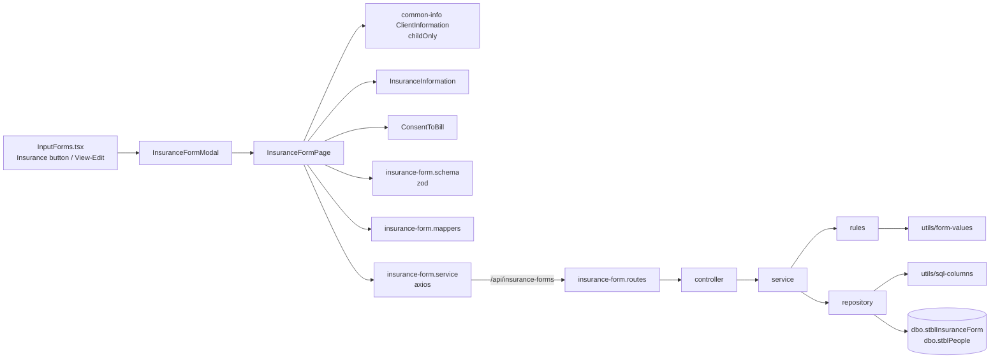

# 01 — Code Annotations: Insurance Form

File-by-file walkthrough of the Insurance Form feature. Line references are to the current code.

---

## 1. Architecture

Request flow for a save: the page checks the form with the zod schema → `valuesToPayload` builds the body → `POST` / `PUT /api/insurance-forms/{childId}[/{id}]` → controller → service: `normalizePayload` → `clearDependentFields` → `validateRecord` → repository `insert` / `update` → the saved row is read back and returned.

## 2. Backend — `backend/src/modules/insurance-form`

| File | Role |
| ---- | ---- |
| [insurance-form.config.ts](../../backend/src/modules/insurance-form/insurance-form.config.ts) | Table name, `FormType` literal, writable columns, consent codes and wording, decline reasons |
| [insurance-form.rules.ts](../../backend/src/modules/insurance-form/insurance-form.rules.ts) | Request parsing, clearing, cross-field validation |
| [insurance-form.service.ts](../../backend/src/modules/insurance-form/insurance-form.service.ts) | Use cases: get, getOne, create, update, remove, lookups |
| [insurance-form.repository.ts](../../backend/src/modules/insurance-form/insurance-form.repository.ts) | SQL against `stblInsuranceForm` and `stblPeople` |
| [insurance-form.controller.ts](../../backend/src/modules/insurance-form/insurance-form.controller.ts) | Express handlers (one line each) |
| [insurance-form.routes.ts](../../backend/src/modules/insurance-form/insurance-form.routes.ts) | 6 routes with Swagger annotations |
| [insurance-form.types.ts](../../backend/src/modules/insurance-form/insurance-form.types.ts), [index.ts](../../backend/src/modules/insurance-form/index.ts) | Types and the router export, mounted at `/api/insurance-forms` in `app.ts` |

### 2.1 [insurance-form.config.ts](../../backend/src/modules/insurance-form/insurance-form.config.ts)

| Location | What it does |
| -------- | ------------ |
| L9 `INSURANCE_FORM_TYPE` | `'Insurance'`, the literal reports filter on (BR-IF-10, 43) |
| L22 `COLUMNS` | The 15 writable columns and their kind (`date`, `int`, `bit`, `text` max 255). Leaving out `InsCoNumber`, `InsuranceName`, `CoverageCode`, `Phone` is what keeps their values (BR-IF-23) |
| L48 `BILLING_CONSENT` | Codes 1/2/3 with the legacy consent wording (BR-IF-30, 37) |
| L69–70 | `BILLING_CONSENT_PRIVATE = 1`, `BILLING_CONSENT_DECLINE = 3` |
| L73 `DECLINE_REASONS` | The four reason columns and their wording |

### 2.2 [insurance-form.rules.ts](../../backend/src/modules/insurance-form/insurance-form.rules.ts)

| Function | What it does |
| -------- | ------------ |
| L30 `normalizePayload` | Keeps only `COLUMNS` keys; parses dates (`YYYY-MM-DD`, real calendar day), whole numbers, bits and text (trim, max length) with the shared [utils/form-values.ts](../../backend/src/utils/form-values.ts); rejects an unknown `BillingConsent` |
| L72 `clearDependentFields(p, consent)` | Clears the other answer's fields for the given consent (BR-IF-35). `consent` defaults to the body's value; `update` passes the saved one when the body doesn't change it |
| L84 `validateRecord(record, dob)` | Date Completed required; dates vs DOB; End ≥ Effective; consent required; per-answer requirements (BR-IF-11, 22, 30–36) |

### 2.3 [insurance-form.service.ts](../../backend/src/modules/insurance-form/insurance-form.service.ts)

| Function | What it does |
| -------- | ------------ |
| L11 `int` | `ChildID` / `ID` must be positive integers (BR-IF-03) |
| L17 `child` | Loads the client or fails with *"Client not found"* (404) |
| L23 `get` | Client + all their forms |
| L39 `create` | normalize → clear → validate against DOB → insert → read back |
| L52 `update` | Loads the saved row (404 if missing) → normalize → clear using the body's consent or the saved one → validate the **merged** row → update |
| L70 `remove` | Deletes; 404 when nothing was deleted |
| L78 `lookups.options` | `{ billingConsent, declineReasons }` |

### 2.4 [insurance-form.repository.ts](../../backend/src/modules/insurance-form/insurance-form.repository.ts)

| Function | What it does |
| -------- | ------------ |
| L11 `getClient` | `ChildID, LastName, FirstName, SS, DOB` from `stblPeople` |
| L30 `findByChildId` | All forms, `FormDate` nulls last, then `FormDate DESC, ID DESC` (the FITP order) |
| L47 `findOne` | One form of the client |
| L62 `insert` | Adds `ChildID` and `FormType = 'Insurance'`, binds each column with the shared [utils/sql-columns.ts](../../backend/src/utils/sql-columns.ts), `OUTPUT INSERTED.ID`, reads the row back |
| L89 `update` | `SET` only the columns sent, plus `LastUpdateDate = GETDATE()`, `LastUpdateUser = SUSER_SNAME()` |
| L118 `remove` | `DELETE` and `@@ROWCOUNT` |

Dates are bound as `nvarchar(10)` `YYYY-MM-DD`: the legacy "SQL Server" ODBC driver rejects date parameters (HY004).

## 3. Frontend — `frontend/src/features/insurance-form`

| File | Role |
| ---- | ---- |
| [pages/InsuranceFormPage.tsx](../../frontend/src/features/insurance-form/pages/InsuranceFormPage.tsx) | Loads client, forms and options; Add / Edit; Save / Cancel |
| [components/InsuranceInformation.tsx](../../frontend/src/features/insurance-form/components/InsuranceInformation.tsx) | Date Completed, company name, policy fields |
| [components/ConsentToBill.tsx](../../frontend/src/features/insurance-form/components/ConsentToBill.tsx) | Consent options, signature dates, Decline sub-section |
| [schemas/insurance-form.schema.ts](../../frontend/src/features/insurance-form/schemas/insurance-form.schema.ts) | zod rules matching the backend |
| [utils/insurance-form.mappers.ts](../../frontend/src/features/insurance-form/utils/insurance-form.mappers.ts) | Row → form values, form values → API body |
| [services/insurance-form.service.ts](../../frontend/src/services/insurance-form.service.ts) | `get`, `create`, `update`, `options` |
| [types/insurance-form.ts](../../frontend/src/types/insurance-form.ts) | Row, response, options, form model, defaults |

### 3.1 [pages/InsuranceFormPage.tsx](../../frontend/src/features/insurance-form/pages/InsuranceFormPage.tsx)

| Part | What it does |
| ---- | ------------ |
| `useEffect` load | `get(childId)` + `options()` in parallel; edit picks the form by ID or closes with *"Insurance Form record not found."* (BR-IF-05) |
| `useForm` | zod resolver built from the client's DOB; validates on submit |
| `saveForm` | `valuesToPayload` → `update` or `create`; success toast; `onSaved` (reload history) or `onClose`; API message on failure via the shared [utils/api-message.ts](../../frontend/src/utils/api-message.ts) |
| render | `ClientInformation childOnly` → `InsuranceInformation dob` → `ConsentToBill options dob` → Cancel / Save |

### 3.2 Components

| Component | Notes |
| --------- | ----- |
| `InsuranceInformation` (L29) | `useWatch` on `BillingConsent` (company name `*` when 1) and `EffectiveDate` (End Date `min`); Date Completed `min` = DOB; text fields `maxLength` 255 |
| `ConsentToBill` (L25) | Option cards for the three consents; signature date for 1/2; `SubSection "Decline"` with the reason cards and the second signature date for 3; both date pickers start at DOB |

Shared pieces from `common-info`: `Field`, `FieldGroup`, `Section` / `SubSection` (`components/FormSection.tsx`), `inputClass`, `radioClass`, `optionClass` (`styles/formStyles.ts`), `ClientInformation` with `childOnly`.

### 3.3 [schemas/insurance-form.schema.ts](../../frontend/src/features/insurance-form/schemas/insurance-form.schema.ts)

| Location | What it does |
| -------- | ------------ |
| L12 `isDate` | `YYYY-MM-DD` that round-trips, so `2026-02-30` is rejected |
| L23 `AFTER_BIRTH` | Date Completed and the signature date of the chosen answer vs DOB |
| L33 `createInsuranceFormSchema(dob)` | Field rules + `superRefine` cross-field rules (BR-IF-11, 22, 30–36) |

### 3.4 [utils/insurance-form.mappers.ts](../../frontend/src/features/insurance-form/utils/insurance-form.mappers.ts)

| Function | What it does |
| -------- | ------------ |
| L17 `recordToValues` | Dates → `YYYY-MM-DD`; `BillingConsent` 1–3 → `'1'`–`'3'`, anything else unchosen; first reason bit set → `declineReason` (BR-IF-50, 51) |
| L42 `valuesToPayload` | Text trimmed / NULL; `declineReason` → the four bits; other answer's signature date sent as NULL (BR-IF-35) |

## 4. Tests

| Area | File | Tests |
| ---- | ---- | ----- |
| Backend rules | `insurance-form.rules.test.ts` | Parsing, clearing (incl. saved consent), every validation message |
| Backend service | `insurance-form.service.test.ts` | Create / update / get / remove, partial updates, 404s |
| Backend repository | `insurance-form.repository.test.ts` | SQL text, parameter types, read-back |
| Backend controller, routes | `insurance-form.controller.test.ts`, `insurance-form.routes.test.ts` | Status codes, route table |
| Frontend page | `InsuranceFormPage.test.tsx` | New / edit, each consent, validation, limits, API errors |
| Frontend schema, mappers, service | `insurance-form.schema.test.ts`, `insurance-form.mappers.test.ts`, `services/insurance-form.service.test.ts` | Rules, mapping both ways, URLs |
| Input Forms tab | `InputForms.test.tsx` | Opens, edits, closes and saves the Insurance modal |

Backend: 100 tests, 100% of lines covered. Frontend: 41 Insurance Form tests plus the Input Forms tab tests.
