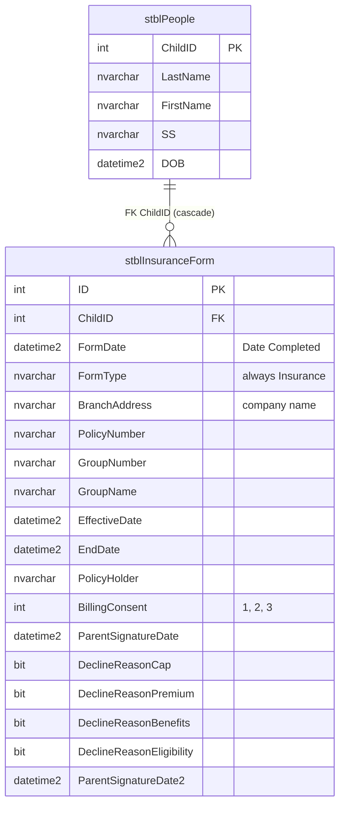
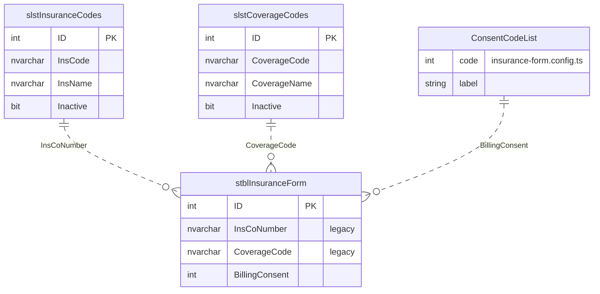

# 07 — Entity-Relationship Diagram: Insurance Form

Built from the local `dbCDD` database. Solid lines are **physical FKs**; dashed lines are **logical** relationships (used by queries, not enforced by the database).

`stblInsuranceForm` has 27 columns. The diagrams show the key and referencing columns plus the columns the form uses; see [04-data-dictionary.md](04-data-dictionary.md) for every column.

---

## 1a. Core: the form and its client

## 1b. Lookups and code lists referenced by the form

Only the referencing columns of `stblInsuranceForm` are shown. The consent and decline-reason lists have **no table** in `dbCDD`; they live in the backend config.

## 2. Relationship catalogue

| # | Parent | Child | Join | Physical FK | On delete | Notes |
| - | ------ | ----- | ---- | ----------- | --------- | ----- |
| R1 | `stblPeople` | `stblInsuranceForm` | `ChildID` | `stblInsuranceForm$stblPeoplestblInsuranceForm` (`WITH NOCHECK`) | **Cascade** | Deleting a client deletes its Insurance Forms; `ON UPDATE CASCADE` too |
| R2 | `slstInsuranceCodes` | `stblInsuranceForm` | `InsCoNumber = InsCode` (text) | No | — | Legacy Ins. Co # dropdown; not on the new screen **[Decision]** |
| R3 | `slstCoverageCodes` | `stblInsuranceForm` | `CoverageCode = CoverageCode` (text) | No | — | Legacy Coverage Code dropdown; form column `nvarchar(5)`, lookup `nvarchar(255)` |
| R4 | *(config)* consent list | `stblInsuranceForm` | `BillingConsent` | No | — | 1 private, 2 Medicaid, 3 decline; no table |
| R5 | `stblInsuranceForm` | FITP extract | latest `FormDate`, then `ID`, per `ChildID` | — | — | `Get_CIS_FITP_Output` reads one form per child (BR-IF-40) |

## 3. Notes for the DBA

1. The only enforced relationship is R1 (cascade), and it was created `WITH NOCHECK`, so SQL Server doesn't trust it for query plans. Re-enable it `WITH CHECK` after confirming there are no orphans.
2. No index on `stblInsuranceForm.ChildID`. The client look-up, the Input Forms history, the FITP "latest form per child" query and the cascade delete all scan the table. An index on `(ChildID, FormDate DESC, ID DESC)` serves all four.
3. The consent codes exist only in code and in the FITP procedures. A lookup table (`slstBillingConsent`) would document 1 and 2 (IF-GAP-04) and let reports join instead of hard-coding `= 3`.
