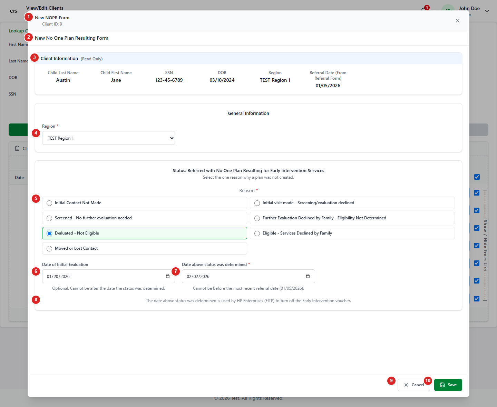
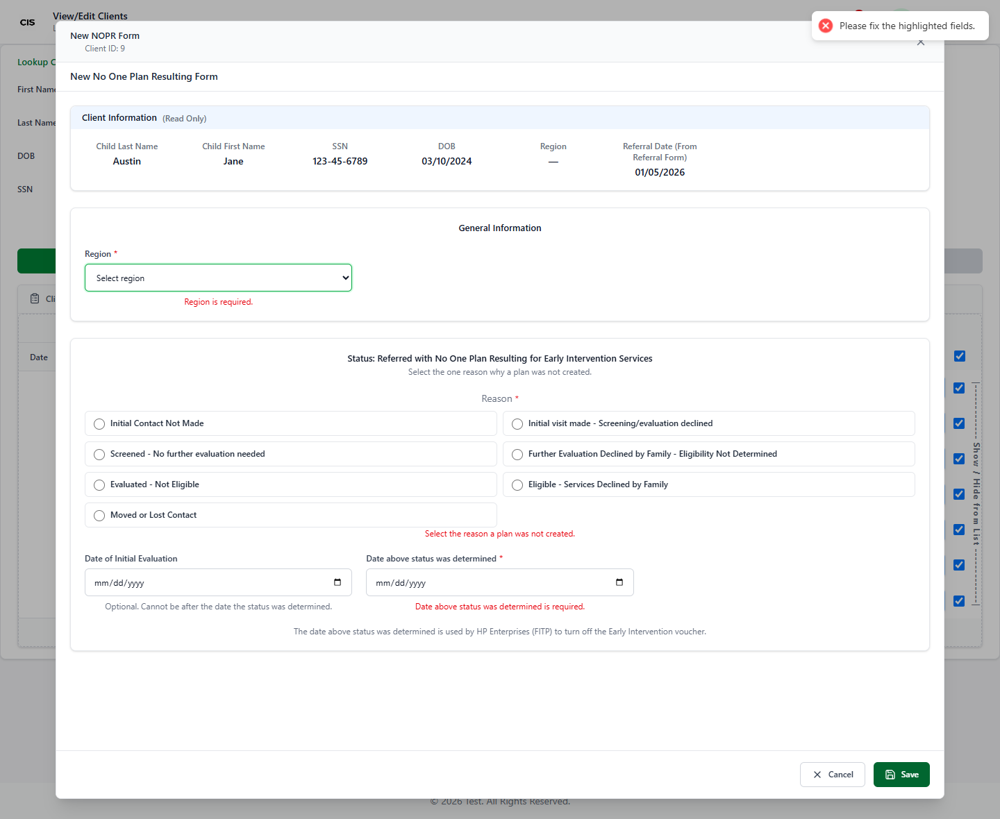
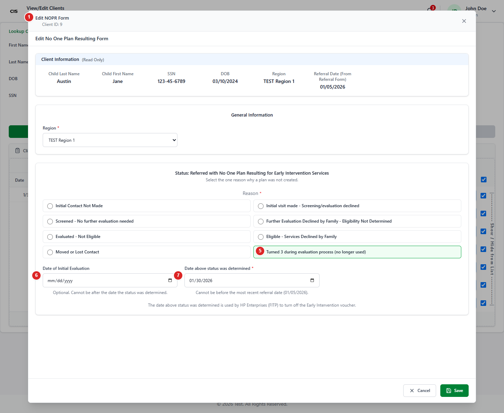
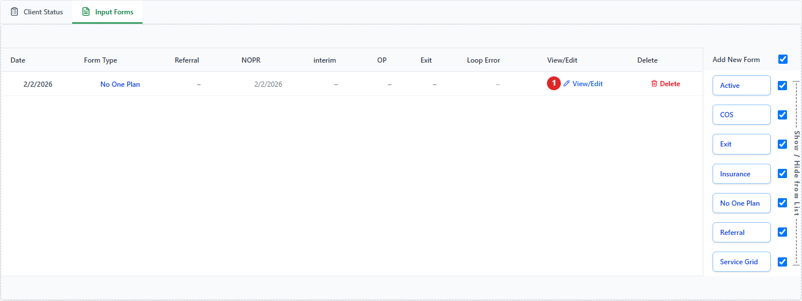

# 00 — Annotated Wireframe: NOPR Form

Screenshots of the NOPR Form as built today, taken from the running application with sample data. The form opens as a full-screen modal from the Client screen → **Input Forms** tab → **No One Plan** (new form) or **View/Edit** on a No One Plan row (edit). Numbered red markers match the tables below. Sample data is fictional.

**Figure 1 — New form, filled in**

**Figure 2 — Save with missing and invalid values**

**Figure 3 — Editing an older form that has the retired reason**

**Figure 4 — The saved form in the Input Forms history**

In Figure 4 both the Date and NOPR columns show the status date (it is saved as `FormDate`, BR-NOPR-11, 12); marker 1, **View/Edit**, opens the form shown in Figure 3. Figure 3 uses a sample older form with reason 7.

---

## Header and Client Information

| # | Element | Type | Behaviour | Data | Rules |
| - | ------- | ---- | --------- | ---- | ----- |
| 1 | Modal header | Title, Client ID, × | "New NOPR Form" / "Edit NOPR Form" and the Client ID. × closes without saving. | `ChildID` | BR-NOPR-01, 06 |
| 2 | Page heading | Text | "New / Edit No One Plan Resulting Form" (repeats the modal title, NOPR-GAP-04). | mode | BR-NOPR-05 |
| 3 | Client Information | Read-only labels | Child Last Name, First Name, SSN (unmasked), DOB (MM/DD/YYYY), Region (the name of the region chosen in 4), Referral Date (From Referral Form) = the most recent referral date. | `stblPeople`, `stblReferralForm` | BR-NOPR-22, 35 |

## General Information

| # | Element | Type | Behaviour | Data | Rules |
| - | ------- | ---- | --------- | ---- | ----- |
| 4 | Region * | Dropdown | Required. A new form starts with the region of the latest Active form, else the latest Referral form, else the client's. | `Region` | BR-NOPR-20, 21 |

Removed from the legacy screen: Month Reporting **[Request]** (column kept, BR-NOPR-23).

## Status: Referred with No One Plan Resulting for Early Intervention Services

| # | Element | Type | Behaviour | Data | Rules |
| - | ------- | ---- | --------- | ---- | ----- |
| 5 | Reason * | 7 option cards (radio) | One choice. **Initial Contact Not Made** (new) is first. The chosen card turns green. The retired reason *"Turned 3 during evaluation process (no longer used)"* is listed only on a form that already has it (Figure 3). | `RefStatus` | BR-NOPR-30 – 32 |
| 6 | Date of Initial Evaluation | Date | **New**, optional. Picker runs from the DOB to the status date. Hint: *"Optional. Cannot be after the date the status was determined."* | `InitialEvalDate` | BR-NOPR-36 |
| 7 | Date above status was determined * | Date | Required. Picker starts at the most recent referral date (or the DOB). Hint: *"Cannot be before the most recent referral date (MM/DD/YYYY)."* Also saved as `FormDate`. | `StatusDate`, `FormDate` | BR-NOPR-11, 33 – 35 |
| 8 | FITP note | Text | *"The date above status was determined is used by HP Enterprises (FITP) to turn off the Early Intervention voucher."* | — | BR-NOPR-39, 40 |

Removed from the legacy screen: Periodic Screening and Referred back to CIS Intake Team **[Request]**; reason 7 for new forms **[Request]** (columns kept, BR-NOPR-38).

## Actions

| # | Element | Behaviour | Rules |
| - | ------- | --------- | ----- |
| 9 | Cancel | Closes without saving (no warning, NOPR-GAP-05). | BR-NOPR-06 |
| 10 | Save | Checks the form. Errors show under each field plus *"Please fix the highlighted fields."* (Figure 2). On success: *"NOPR Form saved successfully."* / *"NOPR Form updated successfully."*, the history reloads (Figure 4) and the modal closes. *"Saving..."* while saving. API errors are shown as a message. | BR-NOPR-06 |

## Screen messages

| Message | When |
| ------- | ---- |
| Region is required. | No region chosen |
| Select the reason a plan was not created. | No reason chosen |
| Date above status was determined is required. | Status date empty |
| Enter a valid date. | A date that isn't a real calendar date |
| Date above status was determined cannot be before Date of Birth. | Status date before DOB |
| Cannot be before the most recent referral date (MM/DD/YYYY). | Status date before the most recent referral |
| Date of Initial Evaluation cannot be before Date of Birth. | Initial evaluation before DOB |
| Cannot be after the date the status was determined. | Initial evaluation after the status date |
| Please fix the highlighted fields. | Save with any error above |
| NOPR Form record not found. | Edit of a form that no longer exists |
| Failed to load NOPR Form. / NOPR Form could not be loaded. | The API can't be reached when opening |
