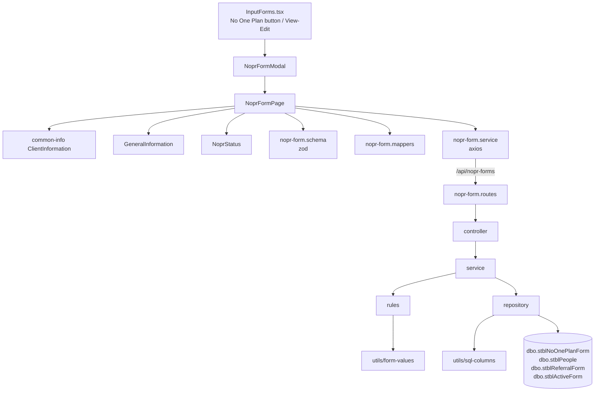

# 01 — Code Annotations: NOPR Form

File-by-file walkthrough of the NOPR Form feature. Line references are to the current code.

---

## 1. Architecture

Request flow for a save: the page checks the form with the zod schema → `valuesToPayload` builds the body → `POST` / `PUT /api/nopr-forms/{childId}[/{id}]` → controller → service: `normalizePayload` → `checkRetiredReason` → `applyFormDate` → `validateRecord` (with the DOB and the most recent referral date) → repository `insert` / `update` → the saved row is read back and returned.

## 2. Backend — `backend/src/modules/nopr-form`

| File | Role |
| ---- | ---- |
| [nopr-form.config.ts](../../backend/src/modules/nopr-form/nopr-form.config.ts) | Table names, `FormType` literal, writable columns, reasons and the retired reason |
| [nopr-form.rules.ts](../../backend/src/modules/nopr-form/nopr-form.rules.ts) | Request parsing, retired-reason check, `FormDate`, cross-field validation |
| [nopr-form.service.ts](../../backend/src/modules/nopr-form/nopr-form.service.ts) | Use cases: get, getOne, create, update, remove, defaults, lookups |
| [nopr-form.repository.ts](../../backend/src/modules/nopr-form/nopr-form.repository.ts) | SQL against `stblNoOnePlanForm`, `stblPeople`, `stblReferralForm`, `stblActiveForm` |
| [nopr-form.controller.ts](../../backend/src/modules/nopr-form/nopr-form.controller.ts) | Express handlers (one line each) |
| [nopr-form.routes.ts](../../backend/src/modules/nopr-form/nopr-form.routes.ts) | 7 routes with Swagger annotations (tag **NOPR Forms**) |
| [nopr-form.types.ts](../../backend/src/modules/nopr-form/nopr-form.types.ts), [index.ts](../../backend/src/modules/nopr-form/index.ts) | Types and the router export, mounted at `/api/nopr-forms` in [app.ts:67](../../backend/src/app.ts#L67) |

### 2.1 [nopr-form.config.ts](../../backend/src/modules/nopr-form/nopr-form.config.ts)

| Location | What it does |
| -------- | ------------ |
| L3–5 | `stblNoOnePlanForm`, plus `stblReferralForm` and `stblActiveForm` for the defaults and the referral date |
| L11 `NOPR_FORM_TYPE` | `'No One Plan'`, the literal the legacy views match (BR-NOPR-10) |
| L25 `COLUMNS` | The 4 columns the request may write: `Region`, `RefStatus` (int), `InitialEvalDate`, `StatusDate` (date). Leaving out `MonthReporting`, `Screening`, `ReferredBack` is what keeps their values (BR-NOPR-23, 38) |
| L35 `SAVED_COLUMNS` | `COLUMNS` + `FormDate`, the columns the repository writes |
| L45 `REF_STATUS` | Reasons in display order: 8 first, then 1–6 (BR-NOPR-31) |
| L59 `RETIRED_REF_STATUS` | Reason 7 (BR-NOPR-32) |

### 2.2 [nopr-form.rules.ts](../../backend/src/modules/nopr-form/nopr-form.rules.ts)

| Function | What it does |
| -------- | ------------ |
| L18 `normalizePayload` | Keeps only `COLUMNS` keys (so `FormDate`, `FormType` and the legacy columns are dropped); parses dates (`YYYY-MM-DD`, real calendar day) and whole numbers with the shared [utils/form-values.ts](../../backend/src/utils/form-values.ts); rejects an unknown `RefStatus` |
| L38 `checkRetiredReason(p, saved)` | Rejects reason 7 unless the saved form already has it (BR-NOPR-32) |
| L46 `applyFormDate` | `FormDate = StatusDate` whenever the body has a status date (BR-NOPR-11) |
| L51 `validateRecord(record, dob, referral)` | Region, reason and status date required; status date vs DOB and the most recent referral; initial evaluation vs DOB and the status date (BR-NOPR-20, 30, 33–36). The referral date in the message is `MM/DD/YYYY` |

### 2.3 [nopr-form.service.ts](../../backend/src/modules/nopr-form/nopr-form.service.ts)

| Function | What it does |
| -------- | ------------ |
| L13 `int` | `ChildID` / `ID` must be positive integers (BR-NOPR-03) |
| L19 `child` | Loads the client or fails with *"Client not found"* (404) |
| L25 `get` | Client + all their forms |
| L41 `create` | normalize → retired check (no saved reason) → `FormDate` → validate against DOB and the most recent referral → insert → read back |
| L56 `update` | Loads the saved row (404 if missing) → normalize → retired check against the saved reason → `FormDate` → validate the **merged** row → update |
| L79 `remove` | Deletes; 404 when nothing was deleted |
| L92 `defaults` | `{ Region, MostRecentReferralDate }` for a new form (BR-NOPR-21, 35) |
| L107 `lookups.options` | `{ refStatus, retiredRefStatus }` |

### 2.4 [nopr-form.repository.ts](../../backend/src/modules/nopr-form/nopr-form.repository.ts)

| Function | What it does |
| -------- | ------------ |
| L14 `getClient` | `ChildID, Region, LastName, FirstName, SS, DOB` from `stblPeople` |
| L34 `findByChildId` | All forms, `FormDate` nulls last, then `FormDate DESC, ID DESC` |
| L51 `findOne` | One form of the client |
| L66 `insert` | Adds `ChildID` and `FormType = 'No One Plan'`, binds each column with the shared [utils/sql-columns.ts](../../backend/src/utils/sql-columns.ts), `OUTPUT INSERTED.ID`, reads the row back |
| L93 `update` | `SET` only the columns sent, plus `LastUpdateDate = GETDATE()`, `LastUpdateUser = SUSER_SNAME()` |
| L122 `remove` | `DELETE` and `@@ROWCOUNT` |
| L142 `findMostRecentReferralDate` | `MAX` over `ReferralDate` and `ReReferralDate` of all the child's Referral forms (`CROSS APPLY (VALUES …)`) |
| L157 `findLatestRegion` | Region of the latest Active form, else the latest Referral form |

Dates are bound as `nvarchar(10)` `YYYY-MM-DD`: the legacy "SQL Server" ODBC driver rejects date parameters (HY004).

## 3. Frontend — `frontend/src/features/nopr-form`

| File | Role |
| ---- | ---- |
| [pages/NoprFormPage.tsx](../../frontend/src/features/nopr-form/pages/NoprFormPage.tsx) | Loads client, forms, regions, options and defaults; Add / Edit; Save / Cancel |
| [components/GeneralInformation.tsx](../../frontend/src/features/nopr-form/components/GeneralInformation.tsx) | Region dropdown |
| [components/NoprStatus.tsx](../../frontend/src/features/nopr-form/components/NoprStatus.tsx) | Reasons, the two dates, the FITP note |
| [schemas/nopr-form.schema.ts](../../frontend/src/features/nopr-form/schemas/nopr-form.schema.ts) | zod rules matching the backend |
| [utils/nopr-form.mappers.ts](../../frontend/src/features/nopr-form/utils/nopr-form.mappers.ts) | Row / defaults → form values, form values → API body |
| [services/nopr-form.service.ts](../../frontend/src/services/nopr-form.service.ts) | `get`, `defaults`, `create`, `update`, `options` |
| [types/nopr-form.ts](../../frontend/src/types/nopr-form.ts) | Row, response, defaults, options, form model |
| [InputForms.tsx:643](../../frontend/src/features/client/components/InputForm/InputForms.tsx#L643) `NoprFormModal` | Full-screen modal that hosts the page from the Input Forms tab |

### 3.1 [pages/NoprFormPage.tsx](../../frontend/src/features/nopr-form/pages/NoprFormPage.tsx)

| Part | What it does |
| ---- | ------------ |
| L52 `useForm` | zod resolver built from the client's DOB and the most recent referral date; validates on submit |
| L60 `useEffect` load | `get`, `regions`, `options` and `defaults` in parallel; edit picks the form by ID or closes with *"NOPR Form record not found."* (BR-NOPR-05); a new form starts from `defaultsToValues`. Results that arrive after the modal closed are ignored |
| L111 `saveForm` | `valuesToPayload` → `update` or `create`; success toast; `onSaved` (reload history) or `onClose`; API message on failure via the shared [utils/api-message.ts](../../frontend/src/utils/api-message.ts) |
| render | `ClientInformation` (region name follows the dropdown, referral date) → `GeneralInformation` → `NoprStatus` → Cancel / Save (*"Saving..."*) |

### 3.2 Components

| Component | Notes |
| --------- | ----- |
| `GeneralInformation` (L12) | `RegionSelect` with `valueAsNumber`; placeholder value `0` (= not chosen) |
| `NoprStatus` (L16) | Option cards for `refStatus`, plus the retired reason only when it equals the saved one; Date of Initial Evaluation `min` = DOB, `max` = status date; status date `min` = referral date or DOB; hints and the FITP note |

Shared pieces from `common-info`: `Field`, `FieldGroup`, `Section`, `RegionSelect`, `inputClass`, `radioClass`, `optionClass`, `ClientInformation`. From [utils/date.ts](../../frontend/src/utils/date.ts): `toDateInput`, `formatDate` and `isCalendarDate` (L21, added for this form).

### 3.3 [schemas/nopr-form.schema.ts](../../frontend/src/features/nopr-form/schemas/nopr-form.schema.ts)

| Location | What it does |
| -------- | ------------ |
| L6 `date` | Empty, or a `YYYY-MM-DD` real calendar date (`isCalendarDate`) |
| L12 `createNoprFormSchema(dob, referral)` | Field rules (Region ≥ 1, reason, status date required) + `superRefine` date rules. Only real dates are compared, so `2026-02-30` shows just *"Enter a valid date."* (BR-NOPR-33 – 37) |

### 3.4 [utils/nopr-form.mappers.ts](../../frontend/src/features/nopr-form/utils/nopr-form.mappers.ts)

| Function | What it does |
| -------- | ------------ |
| L9 `recordToValues` | Dates → `YYYY-MM-DD`; `RefStatus` → string (empty when missing or 0); `Region` → number |
| L20 `defaultsToValues` | Empty form with the default region, else the client's region |
| L31 `valuesToPayload` | `RefStatus` → number; empty dates → `null`. `FormDate` is not sent (the API sets it) |

## 4. Tests

| Area | File | Tests |
| ---- | ---- | ----- |
| Backend rules | `nopr-form.rules.test.ts` | Parsing, retired reason, `FormDate`, every validation message |
| Backend service | `nopr-form.service.test.ts` | Create / update / get / remove / defaults, partial updates, 404s |
| Backend repository | `nopr-form.repository.test.ts` | SQL text, parameter types, read-back, referral date, latest region |
| Backend controller, routes | `nopr-form.controller.test.ts`, `nopr-form.routes.test.ts` | Status codes, route table |
| Frontend page | `NoprFormPage.test.tsx` | New / edit, defaults, reasons, retired reason, date limits, validation, saving state, API errors, closing during load |
| Frontend schema, mappers, service | `nopr-form.schema.test.ts`, `nopr-form.mappers.test.ts`, `services/nopr-form.service.test.ts` | Rules, mapping both ways, URLs |
| Input Forms tab | `InputForms.test.tsx` | Opens, edits, closes and saves the NOPR modal |
| Date helper | `utils/date.test.ts` | `isCalendarDate` |

Backend: 97 NOPR tests, 100% of statements, branches and lines. Frontend: 50 NOPR tests (100% of statements, branches and lines) plus the Input Forms tab and date-helper tests. The whole flow was also run end to end in Chrome against the local database: create, edit, validation messages and delete.
