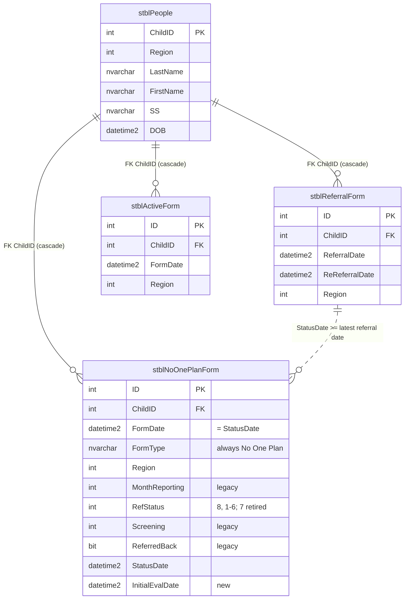
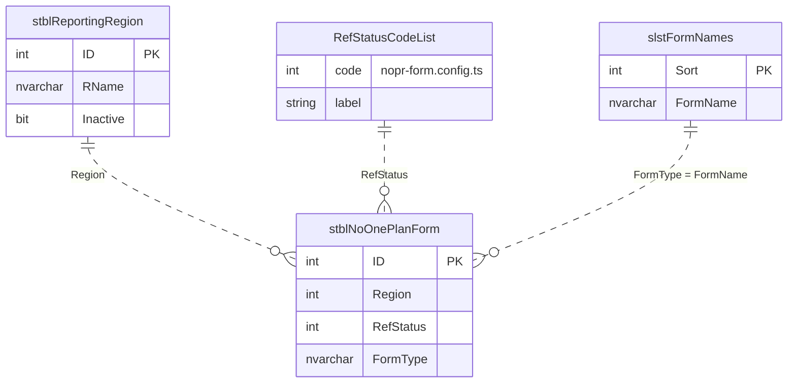

# 07 — Entity-Relationship Diagram: NOPR Form

Built from the local `dbCDD` database. Solid lines are **physical FKs**; dashed lines are **logical** relationships (used by queries, not enforced by the database).

`stblNoOnePlanForm` has 16 columns (15 legacy + `InitialEvalDate`). See [04-data-dictionary.md](04-data-dictionary.md) for every column.

---

## 1a. Core: the form, its client and the forms it reads

## 1b. Lookups and code lists referenced by the form

Only the referencing columns of `stblNoOnePlanForm` are shown. The reason list has **no table** in `dbCDD`; it lives in the backend config.

## 2. Relationship catalogue

| # | Parent | Child | Join | Physical FK | On delete | Notes |
| - | ------ | ----- | ---- | ----------- | --------- | ----- |
| R1 | `stblPeople` | `stblNoOnePlanForm` | `ChildID` | `stblNoOnePlanForm$stblPeoplestblNoOnePlanForm` (`WITH NOCHECK`) | **Cascade** | Deleting a client deletes its NOPR forms; `ON UPDATE CASCADE` too |
| R2 | `stblReferralForm` | `stblNoOnePlanForm` | same `ChildID`; `StatusDate >= MAX(ReferralDate, ReReferralDate)` | No | — | The status date rule (BR-NOPR-35); also FITP pairs each referral with the next exit (R6) |
| R3 | `stblActiveForm` / `stblReferralForm` | `stblNoOnePlanForm` | same `ChildID`; latest `Region` | No | — | Default region for a new form (BR-NOPR-21) |
| R4 | `stblReportingRegion` | `stblNoOnePlanForm` | `Region = ID` | No | — | Region dropdown and name |
| R5 | *(config)* reason list | `stblNoOnePlanForm` | `RefStatus` | No | — | 8, 1–6 active; 7 retired; no table |
| R6 | `stblReferralForm` + `stblExitForm` | `stblNoOnePlanForm` | `ChildID`, first exit `FormDate` after the referral | — | — | FITP exit date (BR-NOPR-40) |
| R7 | `slstFormNames` | `stblNoOnePlanForm` | `FormType = FormName` | No | — | Order of key forms for loop errors and status (BR-NOPR-44, 46) |

## 3. Notes for the DBA

1. The only enforced relationship is R1 (cascade), and it was created `WITH NOCHECK`, so SQL Server doesn't trust it for query plans. Re-enable it `WITH CHECK` after confirming there are no orphans.
2. No index on `stblNoOnePlanForm.ChildID`. The client look-up, the Input Forms history, the FITP exit search and the cascade delete all scan the table. An index on `(ChildID, FormDate)` serves all of them.
3. `Region` has no FK to `stblReportingRegion`, and `RefStatus` has no lookup table: code 8 exists only in the backend and is missing from the column description (NOPR-GAP-10).
